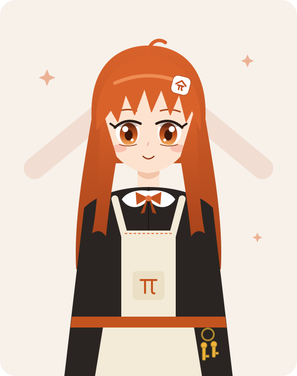

# Mascot: Pia

**Pia** (ピア) is the keeper of the Pistead: Pi + homestead. She looks after the house where your team's agents live. She opens the door for guests, keeps the keys, and never hands out what's in the strongbox.

Each part of her design maps to something Pistead does, so she can explain the product in the places where she shows up.

## Profile

| | |
|---|---|
| Name | Pia (ピア), "Pia of the Stead" |
| Role | Housekeeper and gatekeeper of the homestead |
| Age (vibe) | Young adult, around 20. Never drawn as a child, never fan-service. |
| Height | 158 cm, a little shorter than she acts |
| Likes | Tidy branches, fast-forward pushes, warm tea, guests who say what they need |
| Dislikes | Force pushes, people asking for the API key, unattended stoves (and shells) |
| Catchphrase | 「お許しをいただけますか？」 "May I have your approval?" |

## Personality

- **Diligent and polite, but firm.** She does the work willingly, and for anything that matters (commands, commits, pushes, merges) she stops, bows, and asks. This is the [approvals](../../README.md#approvals-and-permission-requests) model as a character trait.
- **Discreet.** Her host's subscription login and API keys stay in the house. Teammates share the meal, not the pantry key. Ask her for the key and she smiles and changes the subject.
- **A good host.** She remembers each guest, gives them what their grant allows (read, ask, write, approve, manage), and seats them at the same table to follow the conversation.
- **Homebody with a lantern.** She doesn't open the front door to strangers. She walks out to the server herself (the outbound WebSocket), so nobody needs an inbound port.

## Visual design

| Element | Detail | Meaning |
|---|---|---|
| Hair | Long copper-orange, side locks framing the face, jagged bangs | Brand accent `#c4541f` / `#c0491d` |
| Ahoge | A single curled strand on top | The curled leg of the π in the mark |
| Hairpin | The Pistead mark, inverted (white tile, orange strokes) | Logo placement that stays visible at small sizes |
| Eyes | Large amber, gradient from dark rust to gold | Warm hearth light |
| Dress | Charcoal, high neck | The dark theme surface (`#1c1c1c` family) |
| Collar and bow | White Peter Pan collar, orange bow | Clean, approachable |
| Apron | Cream with a π embroidered on the bib pocket and an orange waistband | Homestead, light theme surface (`#f7f7f6` family) |
| Keyring | Two gold keys at the waist | Approvals: nothing opens without a key |
| Background | The roof chevron from the mark | She's at home |

### Palette

| Swatch | Hex | Use |
|---|---|---|
| Hair base | `#d9622b` | Hair, ahoge |
| Hair shadow | `#a8431a` | Gradient bottom, brows, bow shading |
| Hair highlight | `#f6a066` | Angel ring |
| Accent | `#c4541f` | Bow, waistband, embroidery (matches `--accent`) |
| Mark | `#c0491d` | Hairpin strokes, background roof (matches the favicon) |
| Iris | `#5a2410` → `#c4541f` → `#f6b25e` | Eyes |
| Skin | `#fde3cf` / shadow `#f2c4a8` | |
| Dress | `#2a2522` | |
| Apron | `#f3ead8` | |
| Keys | `#f2b438` / `#b08a2e` | |

## Expressions and where they fit

| Expression | Use in the app |
|---|---|
| Bowing, holding out a key | Approval request ("May I run this command?") |
| Hands clasped, smiling | Empty states: no sessions yet, no hosts paired |
| Lantern raised, peering out | Host connecting or reconnecting |
| Sitting on the doorstep, lantern dim | Host offline ("Her house is dark while the host is away.") |
| Finger to lips, key behind her back | Credential or secret prompts ("This stays on the host.") |
| Thumbs up, confetti | Pull request merged, push succeeded |
| Arms crossed, pouting | Refused push (non-fast-forward, wrong branch) |
| Sweeping with a broom | Cleanup, deleting a session or worktree |

## Guidelines

- Keep her wholesome and professional: modest outfit, adult proportions, no suggestive poses. Pistead is a team tool and she should be safe for every screen.
- Keep the hairpin mark and the ahoge in every drawing. They make her recognizable at icon size.
- At small sizes (under 64 px), use only her head: bangs, ahoge, hairpin, eyes.
- She's decoration. Never put information only in her expression: the UI text must stand on its own.

## Assets

- [`docs/images/mascot-pia.svg`](../images/mascot-pia.svg): half-body reference, 600×760, hand-written SVG in the brand palette.
